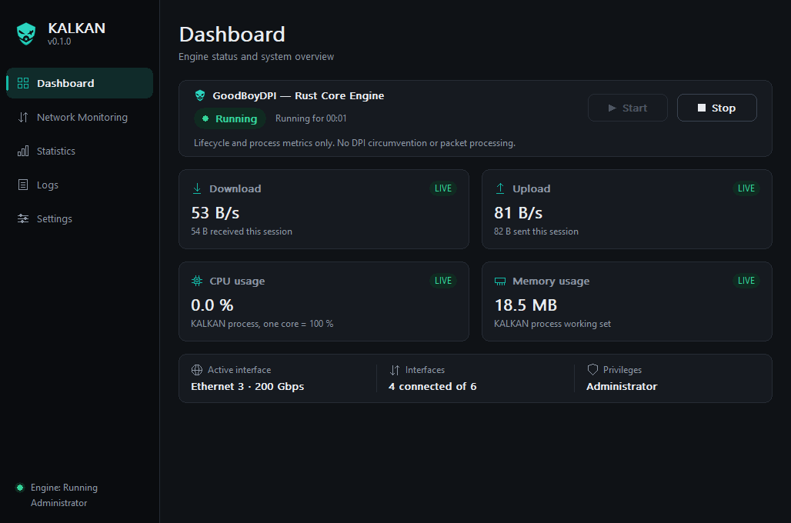
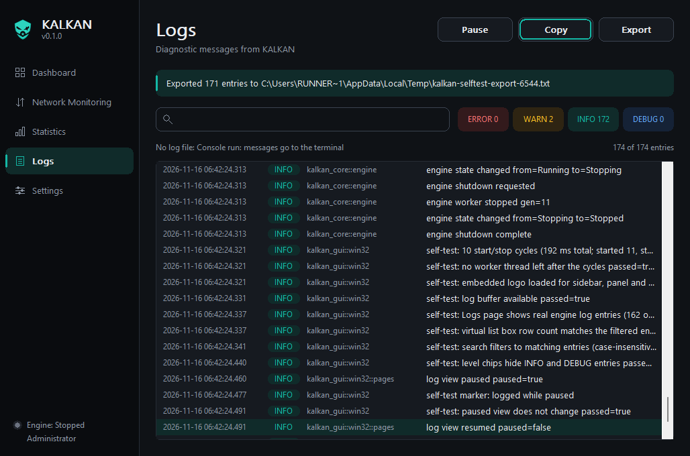
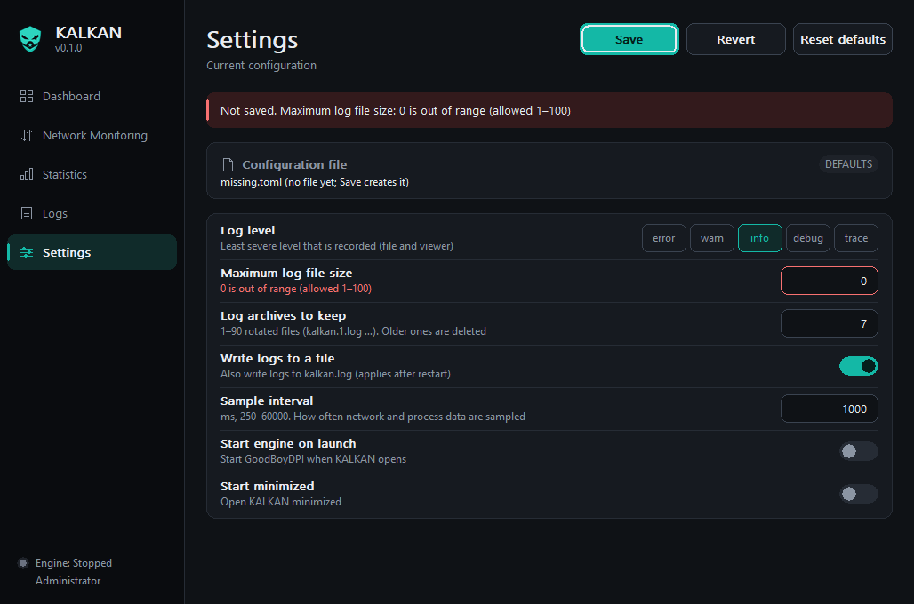
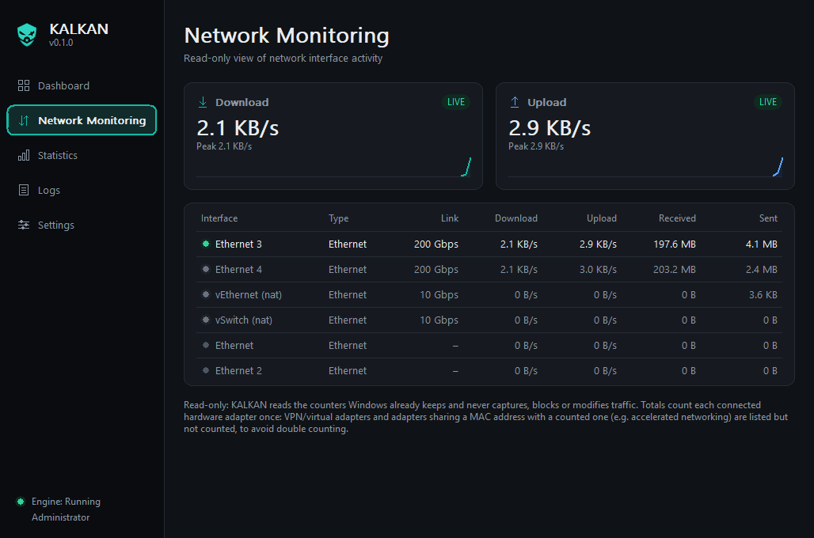
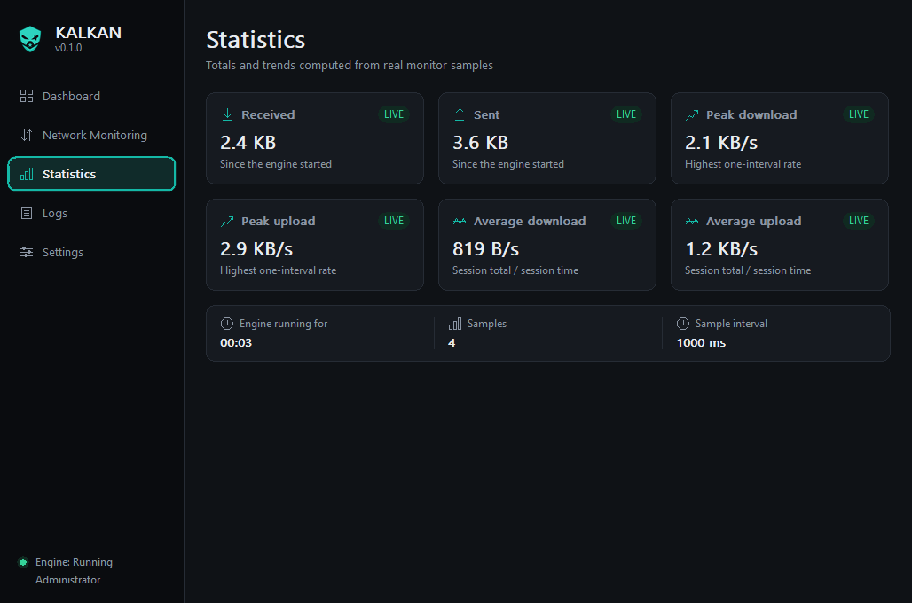
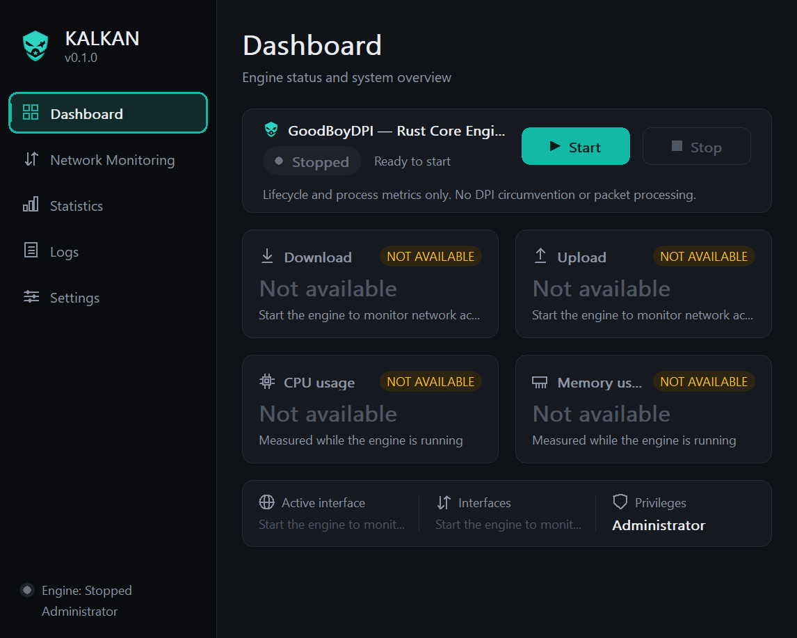
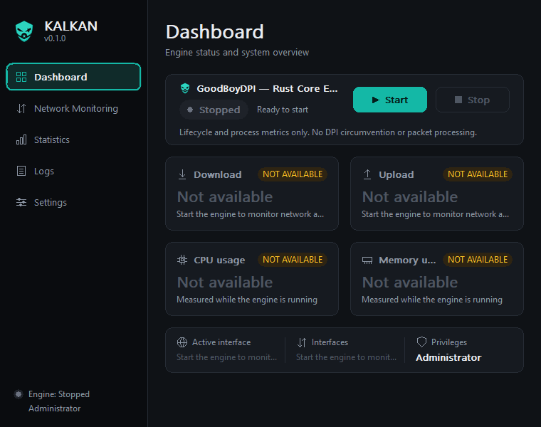

<p align="center"></p>

# 🛡️ KALKAN

**Complex network technology. Simple user experience.**

<p align="center">
  
  
  
  
  
</p>

<p align="center"><b>Lightweight. Native. Reliable.</b></p>

---

## ⚡ What is KALKAN?

KALKAN is an open-source Windows network utility written in Rust. It aims to be lightweight, reliable and easy to use.

Existing network tools are often hard to use. KALKAN puts complex networking operations behind a clean native interface and an efficient background engine.

> Make advanced network technology accessible without making the user deal with unnecessary complexity.

KALKAN is **not** a GUI wrapper around GoodbyeDPI or any other tool. It is an independent application.

## 🚧 Development status

KALKAN is built in phases. A feature is marked ✅ only after it has been compiled and tested.

| Phase | Scope | Status |
|---|---|---|
| 1 | Project foundation and compilation | ✅ Done |
| 2 | Native Win32 GUI | ✅ Done |
| 3 | Core engine lifecycle: GoodBoyDPI (threaded) | ✅ Done |
| 4 | Read-only network monitoring and UI refinement | ✅ Done |
| 5 | Logging (files, rotation, in-app view) and configuration UI | ✅ Done |
| 6 | Performance benchmarking | ⏳ Next |
| 7 | DPI research and controlled integration planning | 🔬 Research |

### Screenshots

Captured automatically by `kalkan --self-test` on the Windows CI runner (CI run 20). The traffic is real and low, because the runner is idle:

<p align="center">
  
</p>

| Logs (real entries, level chips, search) | Settings (editable, validated) |
|---|---|
|  |  |

| Network Monitoring (real interfaces) | Statistics (this session) |
|---|---|
|  |  |

| 150 % display scaling (WM_DPICHANGED) | Minimum window size (760 × 600) |
|---|---|
|  |  |

The data badges mean:
- **LIVE**: measured by the running engine.
- **SYSTEM** / **CONFIG**: read from Windows or from `kalkan.toml`.
- **NOT AVAILABLE**: no value exists. The card says why, for example "Start the engine to monitor network activity". KALKAN never shows invented numbers.

### Network monitoring (read-only)

KALKAN reads the interface counters Windows already keeps, using IP Helper `GetIfTable2`. **It never captures, injects, blocks or modifies packets**, and it needs no driver and no administrator rights.

* **What you see:** download and upload speed with 60-second graphs, session totals, peaks and averages, and every relevant interface with its type, link speed, connection status, live rates and cumulative received/sent bytes.
* **No double counting.** Windows lists each physical adapter several times, once per NDIS filter driver, and those rows are dropped. Totals count each connected **hardware** adapter once:
  - VPN and virtual adapters are listed but not counted, because their traffic also crosses a physical adapter.
  - Adapters that **share a MAC address** with a counted one are listed as duplicates and not counted. This is the case for a Hyper-V NIC and its SR-IOV virtual function under accelerated networking.
  - The CI runner has exactly this setup. Before the MAC rule, a 5 MB download showed as 10 MB.
* **Robust counters:**
  - Counter resets (driver reloads) count as 0, never as a spike.
  - Adapters that are added, removed, connected or disconnected are reported in the notice bar, for example "Wi-Fi disconnected".
  - A newly added adapter's lifetime bytes are not counted as session traffic.
  - If the monitor fails, the reason is shown and process metrics keep working.
* **Cost:** sampling runs on the existing engine worker in the same 1 s tick as process metrics. There is no extra thread or timer, and nothing runs while the engine is stopped.
* `kalkan --interfaces` prints the same table in a terminal, which is useful for diagnosing a user's machine.

### What works today

| Component | Status | Verified by |
|---|---|---|
| GoodBoyDPI engine: controller and worker threads, lifecycle, Start/Stop/QueryStatus/Shutdown, errors, panics, bounded shutdown, no orphaned threads | ✅ | 36 engine tests, repeated 25× per CI build on Windows |
| **Read-only network monitoring:** interfaces, rates, totals, peaks, adapter changes, resets, filter/virtual/same-MAC de-duplication | ✅ | 15 tracker tests with simulated adapters, 7 Windows-side classification tests, a real `GetIfTable2` test on Windows, and the CI end-to-end check: a 5,000,000-byte download made the counted bytes grow by 5,054,232 (1.01×; the rest is background traffic) |
| Process metrics (KALKAN's own CPU and working set) | ✅ | Windows unit test and self-test |
| **Refined native GUI:** teal design tokens, line icons, state pill, hover and hand cursor, logo window and taskbar icon, live Dashboard, Network page with graphs and interface table, Statistics, Logs, Settings | ✅ | 56 GUI unit tests: model, layout, theme, log view, settings form, logo (including WCAG AA contrast for every text/surface pair, and every page fitting at minimum size at 96 to 192 DPI), plus the **63-check** `--self-test`, run 3× per CI build |
| Display scaling | ⚠️ partial | Layout is unit-tested at 96, 120, 144, 168 and 192 DPI. On Windows, the real DPI-change code path was exercised by sending `WM_DPICHANGED` (150 %, screenshot above). The runner's display itself is 96 DPI, so a real high-DPI monitor has not been tested |
| **Log rotation and retention:** size limit, numbered archives, retention, never deleting the active or unrelated files, restart, rename failure, concurrent writers, shutdown while logging | ✅ | 20 `kalkan-logging` tests (rotation, buffer, parsing, history, runtime reload), repeated 40× locally without a failure |
| **Logs page:** real entries, level chips, search, pause/resume, copy, export, file status | ✅ | 8 `logview` tests and the self-test on Windows (clipboard and exported file compared byte-for-byte) |
| **Settings page:** load, edit, validate, save, revert, reset to defaults, live apply, invalid-file backup | ✅ | 16 config and 10 settings-form tests; self-test saves to disk, rejects bad input, resets, and CI run 3 starts from an invalid file and checks the `.bak` |
| GUI-mode log file, `start_engine_on_launch`, start-up error dialog, Save As and Reset dialogs | ⚠️ | Unit-tested where possible. CI runs log to the console, and the self-test calls the code behind the two dialogs instead of clicking them |

**Measurements.** These were taken on the GitHub Actions `windows-latest` VM, CI run 15 unless noted. They are single runs, not a controlled benchmark:

| What | Result |
|---|---|
| One network sample + tracker update (6 interfaces), n = 1000 | mean 647 µs, p99 1.18 ms wall; **0.42 ms CPU per sample**, about 0.04 % of one core at 1 Hz |
| One process-metrics sample | 0.6 µs |
| Engine stopped, 10 s | 0.0 ms CPU |
| Engine running, 10 s (headless) | 0.0 ms here; 15.6 ms in run 13. Windows charges process CPU in about 15.6 ms ticks, so this window can only show 0 or 1 tick; the per-sample figure above is the better estimate |
| Whole app with the **live Network page repainting** every second, 5 s | **0.31 % of one core** (runs 13 and 15) |
| Working set: headless benchmark / GUI after the self-test | 6.6 MiB / about 20 MiB |

**Not tested yet:**
- running on a Windows 10 or 11 desktop
- a standard (non-elevated) user
- real Wi-Fi, cellular or USB adapters
- physically unplugging and re-plugging a cable
- a real high-DPI monitor and moving the window between monitors
- screen readers

Wi-Fi, disconnects, reconnects, adapter removal and counter resets are covered by the simulated-adapter tests only.

### Logs and settings

* **Log files** (GUI runs): `%LOCALAPPDATA%\Kalkan\logs\kalkan.log`. Before a line would make it larger than **Maximum log file size** (default 5 MB), it becomes `kalkan.1.log` and older archives move up; only **Log archives to keep** (default 7) are kept. KALKAN only ever deletes files named exactly `kalkan.<number>.log`, never the active log. File errors are shown on the Logs page, never swallowed.
* **Logs page:** every entry KALKAN logged this run, plus the end of the previous run's file (shown muted). Filter by level, search, pause, copy an entry (Ctrl+C), export to a text file. Timestamps are UTC.
* **Settings page:** log level, file size, archives, file logging, sample interval, start engine on launch, start minimized. Input is validated with the same rules as the config loader before anything is written. The confirmation says which settings apply immediately and which at the next engine start or launch. **Reset defaults** asks first.
* **Invalid `kalkan.toml`:** the window still opens with defaults and shows the error on the Settings page. The file is not touched until you save, and then the old file is kept as `kalkan.toml.bak`.

### Not implemented yet

- Scrolling: very long interface lists are cut off with "+N more"; enlarge the window to see all of them. There is also no light theme and no system tray.
- Any DPI-related functionality (Phase 7, research only). "DPI" in GoodBoyDPI is part of an internal name only.

## 🧠 Architecture

```
kalkan-app ──► kalkan-gui ──► kalkan-core      GoodBoyDPI engine; GUI only speaks EngineLink
     │
     ├──► kalkan-net      read-only counters → rates/totals (NetTracker), no packet API
     ├──► kalkan-config   TOML + validation (also used by the GUI's Settings page)
     ├──► kalkan-logging  tracing → stderr or rotated log file + in-app buffer (also used by the GUI)
     └──► kalkan-win      Windows: GetIfTable2 monitor, privileges, process CPU/memory
```

* **[docs/ARCHITECTURE.md](docs/ARCHITECTURE.md)**: the full design, the lifecycle diagram, the threading model and the extension points.
* **[docs/GUI.md](docs/GUI.md)**: GUI structure, layout, the Logs and Settings pages, the rules that keep displayed data honest, and the self-test.

## 🔧 Building

### On Windows (recommended)

Requirements: [Rust](https://rustup.rs) stable (1.80+) with the MSVC toolchain and the Visual Studio C++ Build Tools.

```powershell
cargo build --release          # -> target\release\kalkan.exe
cargo test --workspace
```

### Cross-compiling from Linux

```bash
rustup target add x86_64-pc-windows-gnu
sudo apt-get install gcc-mingw-w64-x86-64
cargo build --release --target x86_64-pc-windows-gnu
# -> target/x86_64-pc-windows-gnu/release/kalkan.exe
```

Tests for the platform-independent crates run on any OS with `cargo test --workspace`.

### Usage

```text
kalkan                                   # open the window
kalkan --config my.toml                  # open the window with another config file
kalkan --check-config                    # validate the config and exit
kalkan --interfaces                      # list network interfaces and counters
kalkan --benchmark                       # measure monitoring overhead (~25 s)
kalkan --print-default-config > kalkan.toml
kalkan --self-test --screenshots shots   # scripted UI check (used by CI)
```

`kalkan.exe` is a Windows GUI program. When you run CLI options from a terminal, it attaches to that terminal to print its output.

By default the configuration lives at `%APPDATA%\Kalkan\kalkan.toml`. If the file is missing, defaults are used. If it is invalid, `--check-config` lists every problem and exits; the window opens with defaults and shows the problem, and saving keeps the old file as `kalkan.toml.bak`.

## 🎮 Gaming first

Performance is a requirement, not an afterthought:

- No background polling while idle, and no async runtime unless it is justified. The GUI sleeps in `GetMessageW` and uses no timers.
- Monitoring is read-only. It reads OS counters and does no packet processing.
- Phase 6 will measure CPU, memory, latency and jitter. **We do not claim performance numbers until they are measured.**

## 🔐 Security and transparency

- No hidden background processes. Nothing starts without a user action (`start_engine_on_launch = false` by default).
- Antivirus and security software are never disabled.
- No undocumented system modifications. No drivers are installed in Phases 1–6.
- Administrator privileges are not required for monitoring, and the current privilege level is shown to the user.
- `unsafe` code is confined to `kalkan-win` and the GUI's `win32` module, and every block is documented with a `SAFETY:` comment. All other crates and modules forbid or deny `unsafe`.
- Dependencies are small and well known: `windows`, `serde`, `toml`, `thiserror`, `tracing`, `tracing-subscriber`. Phase 5 added no new third-party crate; log rotation, the viewer buffer and ICO loading are written in-tree.

## 🤝 Contributing

Contributions, suggestions, bug reports and technical discussions are welcome. Please check the project issues before submitting major changes.

Before you open a PR, run:

```bash
cargo fmt --all --check
cargo clippy --workspace --all-targets -- -D warnings
cargo test --workspace
```

## 📜 License

KALKAN is released under the [MIT License](LICENSE).
Copyright (c) 2026 Salih Kıvanç TULUM.

<p align="center">Built with 🦀 Rust</p>
