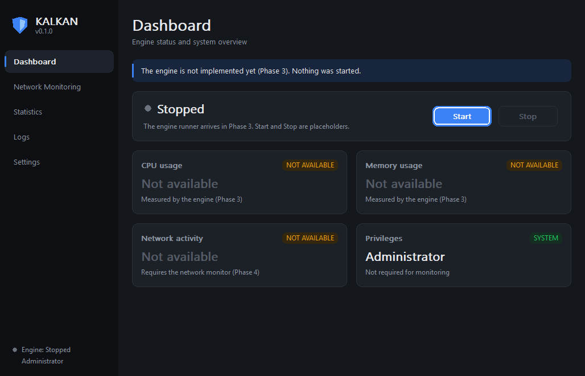
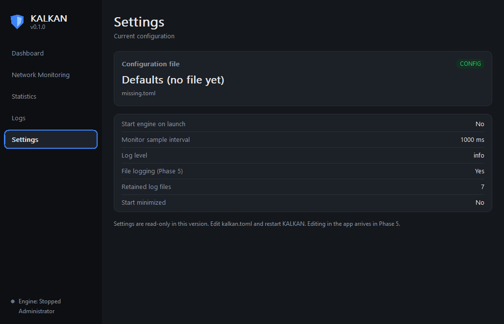

# 🛡️ KALKAN

**Complex network technology. Simple user experience.**

<p align="center">
  
  
  
  
  
</p>

<p align="center"><b>Lightweight. Native. Reliable.</b></p>

---

## ⚡ What is KALKAN?

KALKAN is an open-source Windows network utility written in Rust. It aims to be lightweight, reliable and easy to use.

Existing network tools are often hard to use. KALKAN puts complex networking operations behind a clean native interface and an efficient background engine.

> Make advanced network technology accessible without making the user deal with unnecessary complexity.

KALKAN is **not** a GUI wrapper around GoodbyeDPI or any other tool. It is an independent application.

## 🚧 Development status

KALKAN is built in phases. A feature is marked ✅ only after it has been compiled and tested.

| Phase | Scope | Status |
|---|---|---|
| 1 | Project foundation and compilation | ✅ Done |
| 2 | Native Win32 GUI | ✅ Done |
| 3 | Core engine lifecycle (threaded runner) | ⏳ Next |
| 4 | Read-only network monitoring | 🟡 Planned |
| 5 | Logging (files, rotation, in-app view) and configuration UI | 🟡 Planned |
| 6 | Performance benchmarking | 🟡 Planned |
| 7 | DPI research and controlled integration planning | 🔬 Research |

### Screenshots

Captured automatically by `kalkan --self-test` on the Windows CI runner at 96 DPI:

<p align="center">
  
</p>

| Settings (real config values) | Minimum window size (760 × 560) |
|---|---|
|  |  |

Values marked **NOT AVAILABLE** do not exist yet; KALKAN never shows invented numbers. **SYSTEM** and **CONFIG** values are real, read from Windows and from `kalkan.toml`.

### What works today

| Component | Status | Verified by |
|---|---|---|
| Cargo workspace, 7 crates, shared lints and release profile | ✅ | CI on Windows (MSVC) and Linux (cross-compile to `x86_64-pc-windows-gnu`) |
| Engine lifecycle state machine (`kalkan-core`) | ✅ | 6 unit tests, including an exhaustive transition table |
| GUI ↔ engine protocol and `EngineLink`, with a stand-in engine that reports "nothing was started" | ✅ | 5 unit tests plus the GUI self-test |
| TOML config: defaults, unknown-key rejection, range validation, atomic save | ✅ | 12 unit tests |
| Logging initialisation (`tracing`, stderr) | ✅ | 2 unit tests |
| Read-only `NetworkMonitor` trait, counter and rate math | ✅ | 7 unit tests |
| Administrator-privilege detection and process memory counters (`kalkan-win`) | ✅ | Unit tests on the Windows CI runner |
| **Native Win32 GUI:** sidebar with the 5 pages, Start/Stop placeholders, responsive card grid, minimum size, per-monitor DPI | ✅ | 22 unit tests for the model, layout and theme, plus the 22-check `--self-test` on a real window on Windows CI |
| Start-up errors shown in a dialog when started from Explorer | ⚠️ | Code path compiles. Not exercised by CI, because CI runs only console paths |
| `kalkan` CLI: `--version`, `--config`, `--check-config`, `--print-default-config`, `--self-test` | ✅ | 6 unit tests plus the CI smoke test with exit-code checks |

**Windows runtime coverage so far:** everything above marked ✅ ran on the GitHub Actions `windows-latest` runner (Windows Server, 1024×768, 96 DPI, elevated). The following have **not** been tested yet:
- running on a Windows 10 or 11 desktop
- high-DPI displays and `WM_DPICHANGED` (CI has only 96 DPI)
- moving the window between monitors
- screen readers

**Memory, as observed once:** after the self-test run, the working set was 17.4 MiB (peak 20.6 MiB) and private bytes were 1.9 MiB. This is one observation on a CI runner, not a benchmark. Proper measurements are Phase 6.

### Not implemented yet

- Engine thread and real Start/Stop (Phase 3). The buttons are placeholders and say so.
- CPU and memory metrics on the Dashboard (Phase 3), and real network counters via `GetIfTable2` (Phase 4).
- Log files, rotation and the in-app log view (Phase 5). **In GUI mode, log output is not captured anywhere yet.**
- Editing settings in the app (Phase 5). The Settings page is read-only.
- Hover effects, an application icon resource, scrolling, light theme, system tray, gaming profile and benchmarks.

## 🧠 Architecture

```
kalkan-app ──► kalkan-gui ──► kalkan-core      (GUI only speaks EngineLink: Command/Event)
     │
     ├──► kalkan-net      read-only monitor trait (no packet modification API)
     ├──► kalkan-config   TOML + validation
     ├──► kalkan-logging  tracing
     └──► kalkan-win      Windows queries (privileges, memory, console)
```

* **[docs/ARCHITECTURE.md](docs/ARCHITECTURE.md)**: the full design, the lifecycle diagram, the threading model and the extension points.
* **[docs/GUI.md](docs/GUI.md)**: GUI structure, layout, the rules that keep displayed data honest, and the self-test.

## 🔧 Building

### On Windows (recommended)

Requirements: [Rust](https://rustup.rs) stable (1.80+) with the MSVC toolchain and the Visual Studio C++ Build Tools.

```powershell
cargo build --release          # -> target\release\kalkan.exe
cargo test --workspace
```

### Cross-compiling from Linux

```bash
rustup target add x86_64-pc-windows-gnu
sudo apt-get install gcc-mingw-w64-x86-64
cargo build --release --target x86_64-pc-windows-gnu
# -> target/x86_64-pc-windows-gnu/release/kalkan.exe
```

Tests for the platform-independent crates run on any OS with `cargo test --workspace`.

### Usage

```text
kalkan                                   # open the window
kalkan --config my.toml                  # open the window with another config file
kalkan --check-config                    # validate the config and exit
kalkan --print-default-config > kalkan.toml
kalkan --self-test --screenshots shots   # scripted UI check (used by CI)
```

`kalkan.exe` is a Windows GUI program. When you run CLI options from a terminal, it attaches to that terminal to print its output.

By default the configuration lives at `%APPDATA%\Kalkan\kalkan.toml`. If the file is missing, defaults are used. If the file is invalid, KALKAN lists every problem and exits. It never overwrites your file.

## 🎮 Gaming first

Performance is a requirement, not an afterthought:

- No background polling while idle, and no async runtime unless it is justified. The GUI sleeps in `GetMessageW` and uses no timers.
- Monitoring is read-only. It reads OS counters and does no packet processing.
- Phase 6 will measure CPU, memory, latency and jitter. **We do not claim performance numbers until they are measured.**

## 🔐 Security and transparency

- No hidden background processes. Nothing starts without a user action (`start_engine_on_launch = false` by default).
- Antivirus and security software are never disabled.
- No undocumented system modifications. No drivers are installed in Phases 1–6.
- Administrator privileges are not required for monitoring, and the current privilege level is shown to the user.
- `unsafe` code is confined to `kalkan-win` and the GUI's `win32` module, and every block is documented with a `SAFETY:` comment. All other crates and modules forbid or deny `unsafe`.
- Dependencies are small and well known: `windows`, `serde`, `toml`, `thiserror`, `tracing`, `tracing-subscriber`.

## 🤝 Contributing

Contributions, suggestions, bug reports and technical discussions are welcome. Please check the project issues before submitting major changes.

Before you open a PR, run:

```bash
cargo fmt --all --check
cargo clippy --workspace --all-targets -- -D warnings
cargo test --workspace
```

## 📜 License

KALKAN is released under the [MIT License](LICENSE).
Copyright (c) 2026 Salih Kıvanç TULUM.

<p align="center">Built with 🦀 Rust</p>
