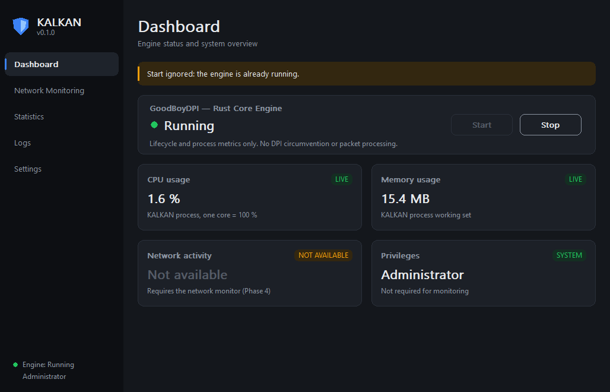

# 🛡️ KALKAN

**Complex network technology. Simple user experience.**

<p align="center">
  
  
  
  
  
</p>

<p align="center"><b>Lightweight. Native. Reliable.</b></p>

---

## ⚡ What is KALKAN?

KALKAN is an open-source Windows network utility written in Rust. It aims to be lightweight, reliable and easy to use.

Existing network tools are often hard to use. KALKAN puts complex networking operations behind a clean native interface and an efficient background engine.

> Make advanced network technology accessible without making the user deal with unnecessary complexity.

KALKAN is **not** a GUI wrapper around GoodbyeDPI or any other tool. It is an independent application.

## 🚧 Development status

KALKAN is built in phases. A feature is marked ✅ only after it has been compiled and tested.

| Phase | Scope | Status |
|---|---|---|
| 1 | Project foundation and compilation | ✅ Done |
| 2 | Native Win32 GUI | ✅ Done |
| 3 | Core engine lifecycle: GoodBoyDPI (threaded) | ✅ Done |
| 4 | Read-only network monitoring | ⏳ Next |
| 5 | Logging (files, rotation, in-app view) and configuration UI | 🟡 Planned |
| 6 | Performance benchmarking | 🟡 Planned |
| 7 | DPI research and controlled integration planning | 🔬 Research |

### Screenshots

Captured automatically by `kalkan --self-test` on the Windows CI runner at 96 DPI:

<p align="center">
  
</p>

| Duplicate Start is rejected | Logs page | Settings (real config values) |
|---|---|---|
|  |  |  |

**LIVE** values come from the running engine. **SYSTEM** and **CONFIG** values are read from Windows and from `kalkan.toml`. Values marked **NOT AVAILABLE** do not exist yet; KALKAN never shows invented numbers.

### The engine: GoodBoyDPI

**GoodBoyDPI — Rust Core Engine** is the internal name of KALKAN's background engine.

> **What it does today:** it starts and stops reliably on its own threads and measures KALKAN's own CPU time and memory. **It contains no DPI circumvention, packet capture or packet modification.** The name does not imply that functionality exists.

* It uses two threads. `kalkan-engine` owns the lifecycle and is idle in a blocking receive. `goodboydpi-core` exists only while the engine is running.
* The GUI is woken with `PostMessageW` and never polls.
* The states are Stopped, Starting, Running, Stopping and Failed. Running is reported only after initialisation succeeds. Invalid commands are rejected with a warning, and failures show the real error.
* Closing the window stops the engine first and waits for its confirmation, bounded by a timeout.

See [docs/ARCHITECTURE.md](docs/ARCHITECTURE.md#the-engine-goodboydpi-kalkan-coreengine) for the threads, the message flow and the concurrency rules.

### What works today

| Component | Status | Verified by |
|---|---|---|
| Cargo workspace, 7 crates, shared lints and release profile | ✅ | CI on Windows (MSVC) and Linux (cross-compile to `x86_64-pc-windows-gnu`) |
| **GoodBoyDPI engine:** controller and worker threads, lifecycle, Start/Stop/QueryStatus/Shutdown, error and panic handling, bounded shutdown, no orphaned threads | ✅ | 31 unit tests in `kalkan-core`: every transition, duplicate and invalid commands, start failure and retry, panics, shutdown, thread termination, and randomized command storms (2 500 commands). Run 25× per CI build on Windows, plus 100 local runs and 30 under full CPU load on Linux |
| Real process metrics: CPU % (one core = 100 %) and working set of KALKAN itself | ✅ | Windows unit test, and the self-test sees live samples about 1 s after Start |
| **Native Win32 GUI** wired to the real engine: Start/Stop, live status, error and warning notices, two-step close | ✅ | 26 unit tests for the model, layout and theme, plus the 37-check `--self-test` with real button clicks, 10 start/stop cycles and close-while-running. Runs 3× per CI build on Windows |
| GUI-mode logging to `%LOCALAPPDATA%\Kalkan\logs\kalkan.log` (one `.old` rollover above 5 MB), panic hook | ✅ | 5 unit tests. ⚠️ CI runs only console mode, so writing the file from a real GUI start has not been exercised on Windows yet |
| TOML config with validation; `start_engine_on_launch` is honoured | ✅ | 12 config tests. ⚠️ The start-on-launch path is not covered by the self-test |
| Read-only `NetworkMonitor` trait, counter and rate math | ✅ | 7 unit tests. Not used by the engine yet (Phase 4) |
| `kalkan` CLI: `--version`, `--config`, `--check-config`, `--print-default-config`, `--self-test` | ✅ | 9 unit tests plus the CI smoke test with exit-code checks |
| Start-up errors shown in a dialog when started from Explorer | ⚠️ | Code path compiles. Not exercised by CI |

**Observed timings and memory (CI runner, one run, not a benchmark):**
- Start → Running in 10 ms.
- Stop → confirmed in 10 ms.
- First CPU sample after 998 ms, matching the 1 s sample interval.
- 10 start/stop cycles in about 190 ms.
- After the self-test: working set 19.5 MiB (peak 20.5 MiB), private bytes 2.0 MiB.

Proper measurements, including idle CPU, are Phase 6.

**Windows runtime coverage so far:** everything above marked ✅ ran on the GitHub Actions `windows-latest` runner (Windows Server, 1024×768, 96 DPI, elevated). The following have **not** been tested yet:
- running on a Windows 10 or 11 desktop
- running as a standard (non-elevated) user
- high-DPI displays and `WM_DPICHANGED`
- moving the window between monitors
- screen readers

### Not implemented yet

- Network monitoring: interface counters via `GetIfTable2` (Phase 4). Network cards say "Not available".
- The in-app log viewer, daily rotation and retention (`logging.max_log_files`), and settings editing (Phase 5).
- Hover effects, an application icon resource, scrolling, light theme, system tray, gaming profile and benchmarks.
- Any DPI-related functionality (Phase 7, research only).

## 🧠 Architecture

```
kalkan-app ──► kalkan-gui ──► kalkan-core      GoodBoyDPI engine; GUI only speaks EngineLink
     │
     ├──► kalkan-net      read-only monitor trait (no packet modification API)
     ├──► kalkan-config   TOML + validation
     ├──► kalkan-logging  tracing → stderr or log file
     └──► kalkan-win      Windows queries (privileges, process CPU/memory, console)
```

* **[docs/ARCHITECTURE.md](docs/ARCHITECTURE.md)**: the full design, the lifecycle diagram, the threading model and the extension points.
* **[docs/GUI.md](docs/GUI.md)**: GUI structure, layout, the rules that keep displayed data honest, and the self-test.

## 🔧 Building

### On Windows (recommended)

Requirements: [Rust](https://rustup.rs) stable (1.80+) with the MSVC toolchain and the Visual Studio C++ Build Tools.

```powershell
cargo build --release          # -> target\release\kalkan.exe
cargo test --workspace
```

### Cross-compiling from Linux

```bash
rustup target add x86_64-pc-windows-gnu
sudo apt-get install gcc-mingw-w64-x86-64
cargo build --release --target x86_64-pc-windows-gnu
# -> target/x86_64-pc-windows-gnu/release/kalkan.exe
```

Tests for the platform-independent crates run on any OS with `cargo test --workspace`.

### Usage

```text
kalkan                                   # open the window
kalkan --config my.toml                  # open the window with another config file
kalkan --check-config                    # validate the config and exit
kalkan --print-default-config > kalkan.toml
kalkan --self-test --screenshots shots   # scripted UI check (used by CI)
```

`kalkan.exe` is a Windows GUI program. When you run CLI options from a terminal, it attaches to that terminal to print its output.

By default the configuration lives at `%APPDATA%\Kalkan\kalkan.toml`. If the file is missing, defaults are used. If the file is invalid, KALKAN lists every problem and exits. It never overwrites your file.

## 🎮 Gaming first

Performance is a requirement, not an afterthought:

- No background polling while idle, and no async runtime unless it is justified. The GUI sleeps in `GetMessageW` and uses no timers.
- Monitoring is read-only. It reads OS counters and does no packet processing.
- Phase 6 will measure CPU, memory, latency and jitter. **We do not claim performance numbers until they are measured.**

## 🔐 Security and transparency

- No hidden background processes. Nothing starts without a user action (`start_engine_on_launch = false` by default).
- Antivirus and security software are never disabled.
- No undocumented system modifications. No drivers are installed in Phases 1–6.
- Administrator privileges are not required for monitoring, and the current privilege level is shown to the user.
- `unsafe` code is confined to `kalkan-win` and the GUI's `win32` module, and every block is documented with a `SAFETY:` comment. All other crates and modules forbid or deny `unsafe`.
- Dependencies are small and well known: `windows`, `serde`, `toml`, `thiserror`, `tracing`, `tracing-subscriber`.

## 🤝 Contributing

Contributions, suggestions, bug reports and technical discussions are welcome. Please check the project issues before submitting major changes.

Before you open a PR, run:

```bash
cargo fmt --all --check
cargo clippy --workspace --all-targets -- -D warnings
cargo test --workspace
```

## 📜 License

KALKAN is released under the [MIT License](LICENSE).
Copyright (c) 2026 Salih Kıvanç TULUM.

<p align="center">Built with 🦀 Rust</p>
